

<picture>
  <source media="(prefers-color-scheme: dark)" srcset="./assets/hero_dark.svg">
  <source media="(prefers-color-scheme: light)" srcset="./assets/hero_light.svg">
  
</picture>

  

 

 

  <picture>
    <source media="(prefers-color-scheme: dark)" srcset="./assets/chat_dark.svg">
    
  </picture>

  <a href="https://github.com/Jkim1647/Jkim1647#for-recruiter">
    <picture>
      <source media="(prefers-color-scheme: dark)" srcset="./assets/path_recruiter_dark.svg">
      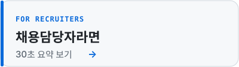
    </picture>
  </a>
  <a href="https://github.com/Jkim1647/Jkim1647#for-developer">
    <picture>
      <source media="(prefers-color-scheme: dark)" srcset="./assets/path_developer_dark.svg">
      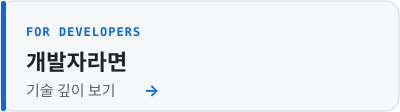
    </picture>
  </a>
  <a href="https://github.com/Jkim1647/Jkim1647#for-ssafy">
    <picture>
      <source media="(prefers-color-scheme: dark)" srcset="./assets/path_ssafy_dark.svg">
      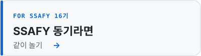
    </picture>
  </a>

 

## 📌 한눈에

  <a href="https://github.com/Jkim1647/portfolio/blob/main/projects/05-hds-integrated-id-card.md">
    <picture>
      <source media="(prefers-color-scheme: dark)" srcset="./assets/card_hds_dark.svg">
      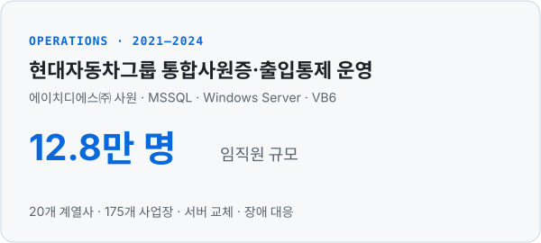
    </picture>
  </a>
  <a href="https://github.com/Jkim1647/portfolio/blob/main/projects/04-sarang-retreat.md">
    <picture>
      <source media="(prefers-color-scheme: dark)" srcset="./assets/card_sarang_dark.svg">
      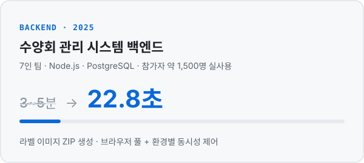
    </picture>
  </a>

  <a href="https://github.com/Jkim1647/sarang-retreat-refactor-notes">
    <picture>
      <source media="(prefers-color-scheme: dark)" srcset="./assets/card_refactor_dark.svg">
      
    </picture>
  </a>
  <a href="https://github.com/Jkim1647/SSAFY-16th-Semester-1-Comprehensive-Project">
    <picture>
      <source media="(prefers-color-scheme: dark)" srcset="./assets/card_ssafy_dark.svg">
      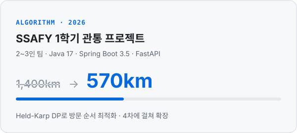
    </picture>
  </a>

  <a href="https://github.com/Jkim1647/ssafy16-ai-challenge-2">
    <picture>
      <source media="(prefers-color-scheme: dark)" srcset="./assets/card_ai2_dark.svg">
      
    </picture>
  </a>
  <a href="https://github.com/Jkim1647/ssafy16-ai-challenge-1">
    <picture>
      <source media="(prefers-color-scheme: dark)" srcset="./assets/card_ai1_dark.svg">
      
    </picture>
  </a>

카드를 누르면 해당 저장소 · 문서로 이동합니다. 아래에서 항목별 상세를 펼쳐 볼 수 있습니다.

## 🧑‍💼 채용담당자 30초 요약

- **지원 분야**: 백엔드 개발 · IT 시스템 운영 · AI 서비스
- **경력**: 에이치디에스㈜ 사원 2021.02–2024.01 — 현대자동차그룹 통합사원증·출입통제 시스템 운영 (20개 계열사 · 175개 사업장 · 임직원 약 12.8만 명)
- **대표 성과**: 수양회 시스템 라벨 ZIP 생성 **3~5분 → 22.8초** · SSAFY AI 챌린지 2차 **217팀 중 2위**
- **학력 · 교육**: 한양대학교 ERICA 스마트ICT융합전공 (GPA 4.0/4.5) · SSAFY 16기 (2026.07 –)
- **자격**: 정보처리기사 · 전자산업기사
- **병역**: 공군 병장 만기전역 (2024.03 – 2025.12)
- **직접 해 보기**: 🚨 [장애 대응 시뮬레이터](https://github.com/Jkim1647/Jkim1647/blob/main/incident.md#start) — 실제로 겪은 장애 3가지를 선택형으로
- **자료**: 📄 [포트폴리오 PDF (14쪽)](https://github.com/Jkim1647/portfolio/blob/main/kim-jinyoung-portfolio.pdf) · ✉️ kjy164777@gmail.com

<a href="https://github.com/Jkim1647/Jkim1647#top">↑ 처음으로</a>

## 👩‍💻 개발자를 위한 기술 깊이

프로젝트마다 무엇을 바꿨고 왜 나아졌는지를 움직이는 그림으로 정리했습니다. 수치는 모두 기록 문서의 측정값이고, 그림을 위해 만든 값은 각 그림 아래에 밝혔습니다.

### ⚙️ 라벨 ZIP 생성 3~5분 → 22.8초

이미지 1장마다 Chromium을 띄우던 라벨 생성을 **브라우저 풀 + 환경별 동시성 제어**로 바꿨습니다. 동시성 값은 감이 아니라 실험 커밋으로 환경별 수치를 재서 정했습니다.

  <picture>
    <source media="(prefers-color-scheme: dark)" srcset="./assets/explainer_dark.svg">
    
  </picture>

### 🧪 2026 리팩토링 — 고정하고, 재고, 고친다

  <picture>
    <source media="(prefers-color-scheme: dark)" srcset="./assets/ex_refactor_dark.svg">
    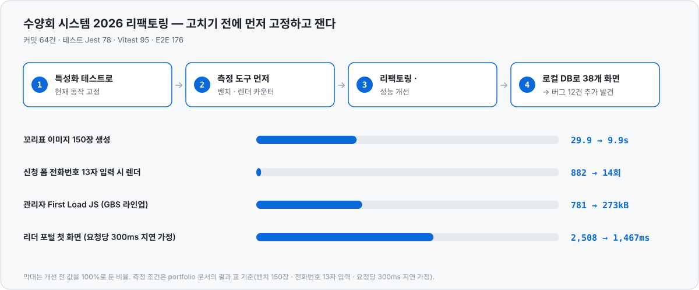
  </picture>

### 🏢 통합사원증 — 데이터 흐름과 장애 추적

  <picture>
    <source media="(prefers-color-scheme: dark)" srcset="./assets/ex_hds_dark.svg">
    
  </picture>

### 🗺️ 여행 동선 1,400.6km → 570.3km

  <picture>
    <source media="(prefers-color-scheme: dark)" srcset="./assets/ex_route_dark.svg">
    
  </picture>

### 🤖 AI 챌린지 — 잘 보여 주고, 모으고, 돌려 묻기

  <picture>
    <source media="(prefers-color-scheme: dark)" srcset="./assets/ex_ai2_dark.svg">
    
  </picture>

  <picture>
    <source media="(prefers-color-scheme: dark)" srcset="./assets/ex_ai1_dark.svg">
    
  </picture>

### 🚨 직접 해 보기

장애를 어떻게 좁혀 가는지는 직접 골라 보며 확인할 수 있어요. 제가 실제로 겪은 장애 3가지로 만들었습니다.

  <a href="https://github.com/Jkim1647/Jkim1647/blob/main/incident.md#start">
    <picture>
      <source media="(prefers-color-scheme: dark)" srcset="./assets/path_incident_dark.svg">
      
    </picture>
  </a>

트러블슈팅과 기술 선택 이유는 아래 **프로젝트 상세**를 펼치거나 [포트폴리오 문서](https://github.com/Jkim1647/portfolio)에서 볼 수 있습니다. <a href="https://github.com/Jkim1647/Jkim1647#top">↑ 처음으로</a>

## 🔍 프로젝트 상세

### 🔧 Backend

<b>사랑의교회 대학부 수양회 관리 시스템</b> · 2025.04–07 · 7인 팀 백엔드 — 라벨 ZIP 생성 <b>3~5분 → 22.8초</b>

 

`Node.js` `Express` `TypeScript` `PostgreSQL` `AWS S3/CloudFront` `Puppeteer` · [상세 문서](https://github.com/Jkim1647/portfolio/blob/main/projects/04-sarang-retreat.md)

- 신청 · 입금 · 숙소 · 셔틀 · 조 편성을 한 시스템에서 관리. 조 편성(GBS) 모듈 공동 개발 — git blame 기준 모듈의 40%, 이미지 생성 유틸 2개 파일 100%
- 이미지 1장마다 Chromium을 띄우던 라벨 생성을 **브라우저 풀 + 환경별 동시성 제어**로 바꿔 ZIP 생성 **3~5분 → 22.8초**
- 행사 일주일 전 운영 서버(EC2)에서만 실패하던 이미지 생성 장애 해결 · 관리자 웹 스냅샷: [sarang-univ-admin](https://github.com/Jkim1647/sarang-univ-admin)

<b>수양회 시스템 2026 리팩토링 기록</b> · 2026.10 · 1인 — 라벨 생성 <b>29.9s → 9.9s</b> · 리렌더 <b>882 → 14</b>

 

`Express` `Knex` `Next.js 14` `SWR` `React Query` `Playwright` `Jest/Vitest` · 1인 (Claude Code 페어 프로그래밍) · [저장소](https://github.com/Jkim1647/sarang-retreat-refactor-notes)

- 서버 · 관리자 웹 · 참가자 웹 세 저장소, 커밋 64건 · 테스트 Jest 78(서버 44 · 관리자 34) · Vitest 95 · E2E 176
- 고치기 전에 **특성화 테스트로 동작을 고정**하고 벤치 · 렌더 카운터 · 번들 크기로 측정 → 라벨 생성 29.9s → 9.9s · 폼 리렌더 882 → 14 · First Load JS −65%
- mock 테스트가 모두 통과한 뒤 **로컬 DB에 붙여 38개 화면을 직접 순회**해 버그 12건을 더 발견 (커밋 뒤 문자 실패가 요청 전체를 500으로 만들던 문제 등)

<b>SSAFY 1학기 관통 프로젝트</b> · 2026.07–10 · 2~3인 팀 — 방문 순서 <b>1,400km → 570km</b>

 

`Java 17` `Spring Boot 3.5` `Maven` `FastAPI` `LangChain` `ChromaDB` · [저장소](https://github.com/Jkim1647/SSAFY-16th-Semester-1-Comprehensive-Project)

- 같은 여행 도메인을 4차에 걸쳐 확장 — Java Swing(1차) → RAG 챗봇(2차, RAGAS Context Recall 0.36 → 1.00) → 공공 API 5종 웹 플래너(3차) → **알고리즘 9종 + Spring Boot 백엔드**(4차)
- 4차: Held-Karp DP로 방문 순서 1,400km → 570km, 배터리 제약 Dijkstra, 자모 단위 편집 거리 오타 검색 — 모두 완전탐색 · JDK · RFC 벡터와 비교 검증

<b>LocalHub — 광주·전라 맛집 커뮤니티</b> · 2026.07 · 3일 · 3인 <b>팀장</b> — 기획부터 배포까지 3일

 

`Vue 3` `Pinia` `Tailwind` `Leaflet` `FastAPI` `Netlify/Render` · [저장소](https://github.com/sc-teamproject/Frontend)

- 맛집 416곳 지도 탐색 · 익명 게시판 · AI 추천 챗봇을 3일 만에 기획부터 배포까지. 프론트 커밋 20건 중 16건, 배포 설정 · 환경 차이 버그 해결

### 🤖 AI

<b>SSAFY AI 챌린지 2차 · 사진 속 글자 읽기 VQA</b> · 5인 팀 — <b>217팀 중 최종 2위</b> (Private 0.98093)

 

`Python` `vLLM` `Qwen3.5` `Gemma 4` `LoRA` · [저장소](https://github.com/Jkim1647/ssafy16-ai-challenge-2)

- 교육생이 직접 찍고 출제한 데이터를 팀원 5명이 다시 라벨링(dev 350문제 검수, 179문제 재작성) → 자체 채점표 401문제를 채택 기준으로 삼음(train 제로샷 상승 AND 채점표 비하락, 최종 제출 2개는 Public 점수 참고)
- 모델을 9B → 122B로 키우는 대신 **4분할 2배 확대 + 받아 적기** 입력으로 0.9445 → 0.9655 (추가 학습 없음)
- 9B~397B 8종의 a~d 확률을 저장해 **확률 평균 앙상블**, 제출 54회의 조합을 GPU 없이 재계산 · Public 11위 → Private 2위

<b>SSAFY AI 챌린지 1차 · 재활용품 VQA</b> · 개인전 — <b>954명 중 18위</b> (상위 1.9%, Private 0.93851)

 

`Python` `Qwen3-VL` `QLoRA` `RunPod A100` · [저장소](https://github.com/Jkim1647/ssafy16-ai-challenge-1)

- 로컬 RTX 5060 Ti의 Qwen3-VL-4B QLoRA에서 시작해 A100의 Qwen3.5-35B-A3B까지 확장
- **선택지 회전 TTA**로 위치 편향 완화 · 모델별 확률 soft ensemble · SHA-256 이미지 해시 grouped validation으로 누수 차단
- Public 12위 → Private 18위의 리더보드 과적합을 2차의 채택 규칙(자체 채점표 비하락)으로 바꿈

<b>사출성형 공정데이터 기반 품질불량 사전예측</b> · 2026 K-인공지능 제조데이터 분석 경진대회 · 1인 제출

 

`Python` `LightGBM` `이상탐지`

- KAMP 사출성형기 데이터로 최종검사 전 불량을 예측하고 검사 우선순위를 정함 · `run_all.py` 한 번으로 표 · 그림 · 보고서 재현 (심사 후 공개 예정)

### 🧱 Foundation

- **[industrial-electronics-skills-competition](https://github.com/Jkim1647/industrial-electronics-skills-competition)** &nbsp;`C` `ATmega128` `OrCAD` — 전국기능경기대회 준비 기록. PCB 설계 Gerber, 엘리베이터 2대 제어(UART), PWM 모터 제어, 회로설계 연습 기록 36회분(2019.08~10). 입상은 마이스터넷에서 공식 확인 가능
- **[Algorithm](https://github.com/Jkim1647/Algorithm)** &nbsp;`Java` — SWEA · 프로그래머스 96문제, BaekjoonHub 자동 커밋

## 🧭 걸어온 길

| 시기 | 내용 |
|---|---|
| 2026.07 – | **SSAFY 16기** (광주) — Java · Spring · 알고리즘 · AI. 부반장 · 스타트캠프 팀장 |
| 2025.04 – 07 | 사랑의교회 대학부 **수양회 관리 시스템 백엔드** — 복무 중 개인 시간에 참여, 2026년 수양회에서도 재사용 |
| 2024.03 – 2025.12 | **공군** 방공관제 지휘소 — 24시간 관제 체계 운용 지원 · 병장 만기전역 |
| 2021.02 – 2024.01 | **에이치디에스㈜** 사원 — 현대자동차그룹 통합사원증 시스템 운영 (MSSQL · Windows Server · VB6) |
| 2020.03 – 2023.02 | **한양대학교 ERICA** 스마트ICT융합전공 — 조기취업형 계약학과로 재직 병행 · GPA 4.0/4.5 |
| 2017 – 2019 | 서울로봇고 공업전자기기 — **전국기능경기대회 장려상 · 서울 금상** · 기능반 동아리장 |

## 🛠 Tech Stack

**결과를 낸 주력 기술** — 위 프로젝트에서 수치로 확인할 수 있는 것

**프로젝트에서 써 본 기술**

## 🏅 자격 · 수상

정보처리기사 (2025.09) · 전자산업기사 (2019.07) · TOEIC Speaking IM2 (2025.01) 
제54회 전국기능경기대회 공업전자기기 장려상 (2019.10) · 서울특별시 지방기능경기대회 금상 (2019.04)

## 💡 일하는 방식

- **측정 먼저** — 동시성 값도 감이 아니라 실험 커밋으로 환경별 수치를 재서 정합니다
- **기준은 직접 만든다** — AI 대회에서는 Public 점수 대신 팀이 재라벨링한 채점표로 채택을 판단했습니다
- **AI 보조는 밝힌다** — AI와 페어로 만든 작업은 어디까지 AI가 했고 무엇을 직접 결정했는지 함께 적습니다

## 🙌 SSAFY 동기라면

16기 광주에서 같이 달리는 중이에요. [Algorithm](https://github.com/Jkim1647/Algorithm)(96문제)와 AI 챌린지 코드([1차](https://github.com/Jkim1647/ssafy16-ai-challenge-1) · [2차](https://github.com/Jkim1647/ssafy16-ai-challenge-2))를 공개해 두었으니 편하게 보시고, 맞팔 환영입니다. 들른 김에 아래에서 하나 빌드하고 가세요 ↓ <a href="https://github.com/Jkim1647/Jkim1647#top">↑ 처음으로</a>

## 🕹️ 같이 빌드하기

방문하신 김에 하나 조립하고 가세요. 버튼을 누르고 이슈를 그대로 제출하면, GitHub Actions가 코드 조각을 그 모양으로 조립해 아래 로그에 **여러분의 아이디**와 함께 남깁니다.

  
  
  
  
  

  <picture>
    <source media="(prefers-color-scheme: dark)" srcset="./assets/buildlog_dark.svg">
    
  </picture>

이슈 제목이 <code>build: robot</code> · <code>car</code> · <code>drone</code> · <code>rocket</code> · <code>ufo</code>일 때만 동작하고, 처리 후 이슈는 자동으로 닫힙니다. 배너의 입자는 지난 1년 기여 달력의 하루하루이며 매일 자동 갱신됩니다 (<code>scripts/</code>, 라이트/다크 자동 전환).
