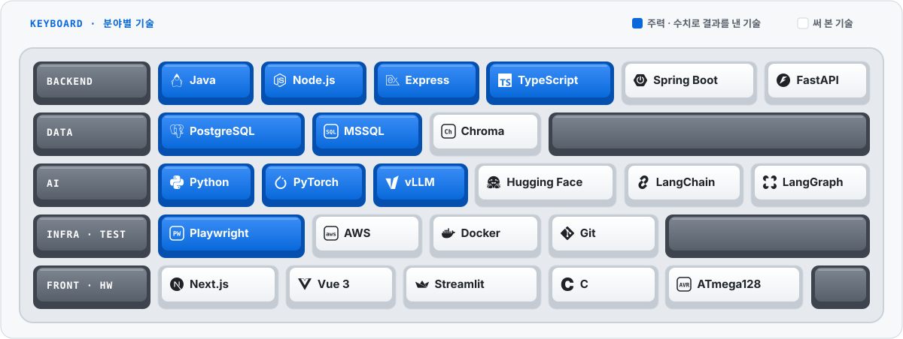

<picture>
  <source media="(prefers-color-scheme: dark)" srcset="./assets/hero_dark.svg">
  <source media="(prefers-color-scheme: light)" srcset="./assets/hero_light.svg">
  
</picture>

 

📄 <a href="https://github.com/Jkim1647/portfolio/blob/main/kim-jinyoung-portfolio.pdf"><b>포트폴리오 PDF</b></a> &nbsp;·&nbsp; 📂 <a href="https://github.com/Jkim1647/portfolio">프로젝트 기록 문서</a> &nbsp;·&nbsp; ✉️ <a href="mailto:kjy164777@gmail.com">kjy164777@gmail.com</a>

 

<b>어디부터 볼까요?</b>

  <a href="https://github.com/Jkim1647/Jkim1647#for-recruiter">
<picture>
  <source media="(prefers-color-scheme: dark)" srcset="./assets/path_recruiter_dark.svg">
  
</picture>
  </a>
  <a href="https://github.com/Jkim1647/Jkim1647#for-developer">
<picture>
  <source media="(prefers-color-scheme: dark)" srcset="./assets/path_developer_dark.svg">
  
</picture>
  </a>
  <a href="https://github.com/Jkim1647/Jkim1647/blob/main/incident.md#start">
<picture>
  <source media="(prefers-color-scheme: dark)" srcset="./assets/path_incident_dark.svg">
  
</picture>
  </a>

 

## 30초 요약

- **지원 분야**: 백엔드 개발 · IT 시스템 운영 · AI 서비스
- **경력**: 에이치디에스㈜ 사원 2021.02–2024.01 — 현대자동차그룹 통합사원증 · 출입통제 시스템 운영 (20개 계열사 · 175개 사업장 · 임직원 약 12.8만 명)
- **대표 성과**: 수양회 시스템 라벨 ZIP 생성 **3~5분 → 22.8초** · SSAFY AI 챌린지 2차 **217팀 중 2위**
- **학력 · 교육**: 한양대학교 ERICA 스마트ICT융합전공 (GPA 4.0/4.5) · SSAFY 16기 (2026.07 –)
- **자격 · 수상**: 정보처리기사 · 전자산업기사 · TOEIC Speaking IM2 · 전국기능경기대회 공업전자기기 장려상 · 서울 지방기능경기대회 금상
- **병역**: 공군 병장 만기전역 (2024.03 – 2025.12)

이력 전체 보기

 

| 시기 | 내용 |
|---|---|
| 2026.07 – | **SSAFY 16기** (광주) — Java · Spring · 알고리즘 · AI. 부반장 · 스타트캠프 팀장 |
| 2025.04 – 07 | 사랑의교회 대학부 **수양회 관리 시스템 백엔드** — 복무 중 개인 시간에 참여, 2026년 수양회에서도 재사용 |
| 2024.03 – 2025.12 | **공군** 방공관제 지휘소 — 24시간 관제 체계 운용 지원 · 병장 만기전역 |
| 2021.02 – 2024.01 | **에이치디에스㈜** 사원 — 현대자동차그룹 통합사원증 시스템 운영 (MSSQL · Windows Server · VB6) |
| 2020.03 – 2023.02 | **한양대학교 ERICA** 스마트ICT융합전공 — 조기취업형 계약학과로 재직 병행 · GPA 4.0/4.5 |
| 2017 – 2019 | 서울로봇고 공업전자기기 — **전국기능경기대회 장려상 · 서울 금상** · 기능반 동아리장 |

## 대표 프로젝트

  <a href="https://github.com/Jkim1647/portfolio/blob/main/projects/05-hds-integrated-id-card.md">
    <picture>
      <source media="(prefers-color-scheme: dark)" srcset="./assets/card_hds_dark.svg">
      
    </picture>
  </a>
  <a href="https://github.com/Jkim1647/portfolio/blob/main/projects/04-sarang-retreat.md">
    <picture>
      <source media="(prefers-color-scheme: dark)" srcset="./assets/card_sarang_dark.svg">
      
    </picture>
  </a>

  <a href="https://github.com/Jkim1647/sarang-retreat-refactor-notes">
    <picture>
      <source media="(prefers-color-scheme: dark)" srcset="./assets/card_refactor_dark.svg">
      
    </picture>
  </a>
  <a href="https://github.com/Jkim1647/SSAFY-16th-Semester-1-Comprehensive-Project">
    <picture>
      <source media="(prefers-color-scheme: dark)" srcset="./assets/card_ssafy_dark.svg">
      
    </picture>
  </a>

  <a href="https://github.com/Jkim1647/ssafy16-safelaw-rag">
    <picture>
      <source media="(prefers-color-scheme: dark)" srcset="./assets/card_safelaw_dark.svg">
      
    </picture>
  </a>
  <a href="https://github.com/Jkim1647/ssafy16-ai-challenge-2">
    <picture>
      <source media="(prefers-color-scheme: dark)" srcset="./assets/card_ai2_dark.svg">
      
    </picture>
  </a>

  <a href="https://github.com/Jkim1647/ssafy16-ai-challenge-1">
    <picture>
      <source media="(prefers-color-scheme: dark)" srcset="./assets/card_ai1_dark.svg">
      
    </picture>
  </a>

카드를 누르면 기록 문서로 이동합니다

## 프로젝트 깊이 보기

펼치면 무엇을 바꿨고 왜 나아졌는지를 움직이는 그림과 함께 볼 수 있습니다. 수치는 기록 문서의 측정값이고, 그림을 위해 만든 값은 그림 아래에 밝혔습니다.

**Backend**

<b>현대자동차그룹 통합사원증 · 출입통제 시스템 운영</b> · 에이치디에스㈜ 2021.02–2024.01 — 임직원 <b>약 12.8만 명</b>

 

<picture>
  <source media="(prefers-color-scheme: dark)" srcset="./assets/ex_hds_dark.svg">
  
</picture>

`MSSQL` `Windows Server` `VB6` `SQL Server Profiler` · [상세 문서](https://github.com/Jkim1647/portfolio/blob/main/projects/05-hds-integrated-id-card.md)

- 20개 계열사 · 175개 사업장이 사원증 하나로 출입 · 식당 · 통근버스를 이용하도록 인사 데이터와 카드사 · 출입통제 · 식수 시스템을 잇는 시스템의 운영 · 유지보수 · 장애 대응 (수도권 사업장 담당)
- 통합사원증 서버 교체(2023-08, 기여도 40%) — 주말 5시간 안에 6단계를 순서대로 점검해 월요일 출근 전에 이관
- 로그인 · 출입 요청 폭주 장애 — DB 세션 락 누적 · 비효율 실행계획을 로그로 찾아 세션 분리 → 인덱스 조정 · 테이블 분할 ([시뮬레이터 시나리오 1](https://github.com/Jkim1647/Jkim1647/blob/main/incident.md#s1))

<b>사랑의교회 대학부 수양회 관리 시스템</b> · 2025.04–07 · 7인 팀 백엔드 — 라벨 ZIP 생성 <b>3~5분 → 22.8초</b>

 

<picture>
  <source media="(prefers-color-scheme: dark)" srcset="./assets/explainer_dark.svg">
  
</picture>

`Node.js` `Express` `TypeScript` `PostgreSQL` `AWS S3/CloudFront` `Puppeteer` · [상세 문서](https://github.com/Jkim1647/portfolio/blob/main/projects/04-sarang-retreat.md)

- 신청 · 입금 · 숙소 · 셔틀 · 조 편성을 한 시스템에서 관리. 조 편성(GBS) 모듈 공동 개발 — git blame 기준 모듈의 40%, 이미지 생성 유틸 2개 파일 100%
- 이미지 1장마다 Chromium을 띄우던 라벨 생성을 **브라우저 풀 + 환경별 동시성 제어**로 바꿔 ZIP 생성 **3~5분 → 22.8초**
- 행사 일주일 전 운영 서버(EC2)에서만 실패하던 이미지 생성 장애 해결 · 관리자 웹 스냅샷: [sarang-univ-admin](https://github.com/Jkim1647/sarang-univ-admin)

<b>수양회 시스템 2026 리팩토링 기록</b> · 2026.10 · 1인 — 라벨 생성 <b>29.9s → 9.9s</b> · 리렌더 <b>882 → 14</b>

 

<picture>
  <source media="(prefers-color-scheme: dark)" srcset="./assets/ex_refactor_dark.svg">
  
</picture>

`Express` `Knex` `Next.js 14` `SWR` `React Query` `Playwright` `Jest/Vitest` · 1인 (Claude Code 페어 프로그래밍) · [저장소](https://github.com/Jkim1647/sarang-retreat-refactor-notes)

- 서버 · 관리자 웹 · 참가자 웹 세 저장소, 커밋 64건 · 테스트 Jest 78(서버 44 · 관리자 34) · Vitest 95 · E2E 176
- 고치기 전에 **특성화 테스트로 동작을 고정**하고 벤치 · 렌더 카운터 · 번들 크기로 측정 → 라벨 생성 29.9s → 9.9s · 폼 리렌더 882 → 14 · First Load JS −65%
- mock 테스트가 모두 통과한 뒤 **로컬 DB에 붙여 38개 화면을 직접 순회**해 버그 12건을 더 발견 (커밋 뒤 문자 실패가 요청 전체를 500으로 만들던 문제 등)

<b>SSAFY 1학기 관통 프로젝트</b> · 2026.07–10 · 2~3인 팀 — 방문 순서 <b>1,400km → 570km</b>

 

<picture>
  <source media="(prefers-color-scheme: dark)" srcset="./assets/ex_route_dark.svg">
  
</picture>

`Java 17` `Spring Boot 3.5` `Maven` `FastAPI` `LangChain` `ChromaDB` · [저장소](https://github.com/Jkim1647/SSAFY-16th-Semester-1-Comprehensive-Project)

- 같은 여행 도메인을 4차에 걸쳐 확장 — Java Swing(1차) → RAG 챗봇(2차, RAGAS Context Recall 0.36 → 1.00) → 공공 API 5종 웹 플래너(3차) → **알고리즘 9종 + Spring Boot 백엔드**(4차)
- 4차: Held-Karp DP로 방문 순서 1,400km → 570km, 배터리 제약 Dijkstra, 자모 단위 편집 거리 오타 검색 — 모두 완전탐색 · JDK · RFC 벡터와 비교 검증

<b>LocalHub — 광주·전라 맛집 커뮤니티</b> · 2026.07 · 3일 · 3인 <b>팀장</b> — 기획부터 배포까지 3일

 

`Vue 3` `Pinia` `Tailwind` `Leaflet` `FastAPI` `Netlify/Render` · [저장소](https://github.com/sc-teamproject/Frontend)

- 맛집 416곳 지도 탐색 · 익명 게시판 · AI 추천 챗봇을 3일 만에 기획부터 배포까지. 프론트 커밋 20건 중 16건, 배포 설정 · 환경 차이 버그 해결

**AI**

<b>SafeLaw — 개인정보 보호형 생활법률 RAG</b> · 2026.10 · 개인 · SSAFY AI 코어 프로젝트 2회차 — 일상어 질문 Top-5 <b>17/17</b>

 

<picture>
  <source media="(prefers-color-scheme: dark)" srcset="./assets/ex_safelaw_dark.svg">
  
</picture>

`Python` `LangGraph` `Chroma` `Streamlit` `FastAPI` · [저장소](https://github.com/Jkim1647/ssafy16-safelaw-rag)

근로계약 · 부당해고, 전세 · 임대차 보증금, 상속 상담에서 관련 법령과 유사 판례, 판단 요소를 근거와 함께 보여 주는 의사결정 보조 도구입니다 (승소 · 패소는 단정하지 않음).

- **개인정보 마스킹** — 외부 모델을 부르기 전 로컬에서 이름 · 주민등록번호 · 전화번호 · 이메일 · 주소를 플레이스홀더로 바꾸고, 원문과 치환 매핑은 파일 · 로그 · Vector DB에 남기지 않음. 외부 모델은 "누가"를 모른 채 "무슨 일"만 보고 근거를 찾음
- **일상어 → 법률 용어** — 도메인 규칙과 LLM이 일상 표현을 법률 용어로 바꾸고 원문 질문과 함께 순위를 합침 → 정답 조문 제목과 단어가 하나도 겹치지 않는 질문 **17/17 Top-5**(초기 10/17). 답변의 `서면통지` · `대항력` 같은 용어는 50개 용어집으로 쉽게 풀이
- **근거 RAG** — 국가법령정보센터 현행 법령 381개 조문 · 공개 판례 50건을 Chroma에 색인, LangGraph `retrieve` → `generate`로 답하고 **인용 문구가 원문에 그대로 있는지 코드로 검증**, 확인되지 않으면 답하지 않음
- 30문항 평가: 법령 Recall@5 1.000 · 판례 Recall@5 0.933 · 인용 정확성 1.000 · 응답 31.8~64.0초 → 8.3~16.7초(대신 E2E 성공률 0.750 → 0.667) · 테스트 168개 — 정답 라벨은 개발자 작성으로 법률 전문가 검수 전

<b>SSAFY AI 챌린지 2차 · 사진 속 글자 읽기 VQA</b> · 5인 팀 — <b>217팀 중 최종 2위</b> (Private 0.98093)

 

<picture>
  <source media="(prefers-color-scheme: dark)" srcset="./assets/ex_ai2_dark.svg">
  
</picture>

`Python` `vLLM` `Qwen3.5` `Gemma 4` `LoRA` · [저장소](https://github.com/Jkim1647/ssafy16-ai-challenge-2)

- 교육생이 직접 찍고 출제한 데이터를 팀원 5명이 다시 라벨링(dev 350문제 검수, 179문제 재작성) → 자체 채점표 401문제를 채택 기준으로 삼음(train 제로샷 상승 AND 채점표 비하락, 최종 제출 2개는 Public 점수 참고)
- 모델을 9B → 122B로 키우는 대신 **4분할 2배 확대 + 받아 적기** 입력으로 0.9445 → 0.9655 (추가 학습 없음)
- 9B~397B 8종의 a~d 확률을 저장해 **확률 평균 앙상블**, 제출 54회의 조합을 GPU 없이 재계산 · Public 11위 → Private 2위

<b>SSAFY AI 챌린지 1차 · 재활용품 VQA</b> · 개인전 — <b>954명 중 18위</b> (상위 1.9%, Private 0.93851)

 

<picture>
  <source media="(prefers-color-scheme: dark)" srcset="./assets/ex_ai1_dark.svg">
  
</picture>

`Python` `Qwen3-VL` `QLoRA` `RunPod A100` · [저장소](https://github.com/Jkim1647/ssafy16-ai-challenge-1)

- 로컬 RTX 5060 Ti의 Qwen3-VL-4B QLoRA에서 시작해 A100의 Qwen3.5-35B-A3B까지 확장
- **선택지 회전 TTA**로 위치 편향 완화 · 모델별 확률 soft ensemble · SHA-256 이미지 해시 grouped validation으로 누수 차단
- Public 12위 → Private 18위의 리더보드 과적합을 2차의 채택 규칙(자체 채점표 비하락)으로 바꿈

<b>사출성형 공정데이터 기반 품질불량 사전예측</b> · 2026 K-인공지능 제조데이터 분석 경진대회 · 1인 제출

 

`Python` `LightGBM` `이상탐지`

- KAMP 사출성형기 데이터로 최종검사 전 불량을 예측하고 검사 우선순위를 정함 · `run_all.py` 한 번으로 표 · 그림 · 보고서 재현 (심사 후 공개 예정)

**Foundation**

- **[industrial-electronics-skills-competition](https://github.com/Jkim1647/industrial-electronics-skills-competition)** &nbsp;`C` `ATmega128` `OrCAD` — 전국기능경기대회 준비 기록. PCB 설계 Gerber, 엘리베이터 2대 제어(UART), PWM 모터 제어, 회로설계 연습 기록 36회분(2019.08~10). 입상은 마이스터넷에서 공식 확인 가능
- **[Algorithm](https://github.com/Jkim1647/Algorithm)** &nbsp;`Java` — SWEA · 프로그래머스 96문제, BaekjoonHub 자동 커밋

## 기술 스택

  <picture>
    <source media="(prefers-color-scheme: dark)" srcset="./assets/stack_dark.svg">
    
  </picture>

## 일하는 방식

- **측정 먼저** — 동시성 값도 감이 아니라 실험 커밋으로 환경별 수치를 재서 정합니다
- **기준은 직접 만든다** — AI 대회에서는 Public 점수 대신 팀이 재라벨링한 채점표로 채택을 판단했습니다
- **AI 보조는 밝힌다** — AI와 페어로 만든 작업은 어디까지 AI가 했고 무엇을 직접 결정했는지 함께 적습니다

배너의 입자는 지난 1년 기여 달력의 하루하루이며 매일 자동 갱신됩니다. <a href="https://github.com/Jkim1647/Jkim1647#top">↑ 처음으로</a>
