

<picture><source media="(prefers-color-scheme: dark)" srcset="./assets/incident/banner_dark.svg"></picture>

<a href="#s1"><picture><source media="(prefers-color-scheme: dark)" srcset="./assets/incident/menu1_dark.svg">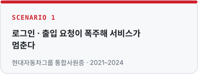</picture></a>
<a href="#s2"><picture><source media="(prefers-color-scheme: dark)" srcset="./assets/incident/menu2_dark.svg">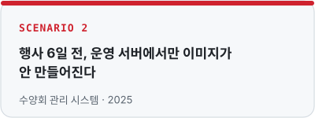</picture></a>
<a href="#s3"><picture><source media="(prefers-color-scheme: dark)" srcset="./assets/incident/menu3_dark.svg">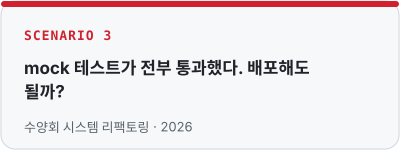</picture></a>

<a href="https://github.com/Jkim1647">↩ 프로필로 돌아가기</a>

                                                  

---

## 1-1. 요청 폭주, 서비스 중단

<picture><source media="(prefers-color-scheme: dark)" srcset="./assets/incident/sc_s1_dark.svg">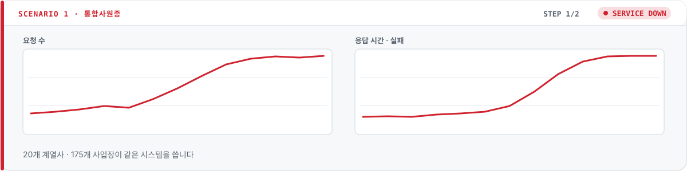</picture>

사원증 로그인과 출입 요청이 한꺼번에 몰리면서 **서비스가 멈췄습니다.** 무엇부터 하시겠어요?

<a href="#s1-restart"><picture><source media="(prefers-color-scheme: dark)" srcset="./assets/incident/ch_s1_A_dark.svg">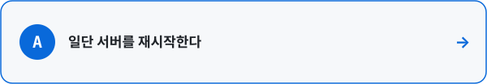</picture></a>
<a href="#s1-logs"><picture><source media="(prefers-color-scheme: dark)" srcset="./assets/incident/ch_s1_B_dark.svg">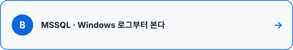</picture></a>

                                                  

---

## 🤔 잠깐 살아납니다, 그런데…

<picture><source media="(prefers-color-scheme: dark)" srcset="./assets/incident/sc_s1-restart_dark.svg"></picture>

재시작하면 몇 분은 버팁니다. 하지만 요청이 다시 몰리면 **같은 일이 반복**됩니다.

<a href="#s1"><picture><source media="(prefers-color-scheme: dark)" srcset="./assets/incident/btn_retry_dark.svg"></picture></a>

                                                  

---

## 1-2. 로그가 말해 준 것

<picture><source media="(prefers-color-scheme: dark)" srcset="./assets/incident/sc_s1-logs_dark.svg"></picture>

**동시 인증 부하 속에 DB 세션 락이 쌓이고** 있었고, **쿼리 실행계획도 비효율적**이었습니다. 사용자들은 지금도 기다리는 중입니다. 지금 당장은?

<a href="#s1-index-first"><picture><source media="(prefers-color-scheme: dark)" srcset="./assets/incident/ch_s1-logs_A_dark.svg">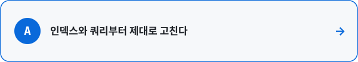</picture></a>
<a href="#s1-end"><picture><source media="(prefers-color-scheme: dark)" srcset="./assets/incident/ch_s1-logs_B_dark.svg">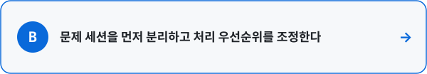</picture></a>

                                                  

---

## 🤔 맞는 방향, 틀린 순서

<picture><source media="(prefers-color-scheme: dark)" srcset="./assets/incident/sc_s1-index-first_dark.svg"></picture>

인덱스 조정은 근본 대책이 맞습니다. 하지만 검증까지 시간이 걸리고, 그동안 **사용자들은 계속 기다립니다.** 먼저 서비스를 살리고, 근본 원인은 그다음입니다.

<a href="#s1-logs"><picture><source media="(prefers-color-scheme: dark)" srcset="./assets/incident/btn_retry_dark.svg"></picture></a>

                                                  

---

## 🏁 실제로는 이렇게 했어요

<picture><source media="(prefers-color-scheme: dark)" srcset="./assets/incident/sc_s1-end_dark.svg"></picture>

> 여러 회사가 같은 시스템을 쓰면 작은 오류도 파급이 큽니다. 추측보다 로그 · 데이터로 범위를 먼저 좁히고, 대응 순서는 문서로 남깁니다.

📄 <a href="https://github.com/Jkim1647/portfolio/blob/main/projects/05-hds-integrated-id-card.md">통합사원증 시스템 운영 기록</a>

<a href="#start"><picture><source media="(prefers-color-scheme: dark)" srcset="./assets/incident/btn_menu_dark.svg"></picture></a>

                                                  

---

## 2-1. 행사 6일 전

<picture><source media="(prefers-color-scheme: dark)" srcset="./assets/incident/sc_s2_dark.svg"></picture>

참가자 약 1,500명의 라벨 이미지를 만드는 기능이 **운영 서버(EC2)에서만 실패**합니다. 어디부터 보시겠어요?

<a href="#s2-code"><picture><source media="(prefers-color-scheme: dark)" srcset="./assets/incident/ch_s2_A_dark.svg">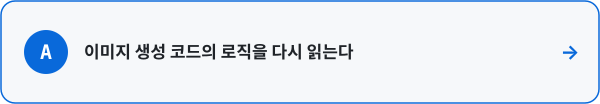</picture></a>
<a href="#s2-env"><picture><source media="(prefers-color-scheme: dark)" srcset="./assets/incident/ch_s2_B_dark.svg">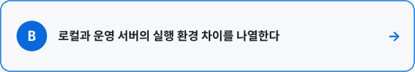</picture></a>

                                                  

---

## 🤔 같은 코드인데요

<picture><source media="(prefers-color-scheme: dark)" srcset="./assets/incident/sc_s2-code_dark.svg"></picture>

코드가 아니라 **코드가 도는 환경**이 다를 가능성이 훨씬 큽니다.

<a href="#s2"><picture><source media="(prefers-color-scheme: dark)" srcset="./assets/incident/btn_retry_dark.svg"></picture></a>

                                                  

---

## 2-2. 원인 후보 세 가지

<picture><source media="(prefers-color-scheme: dark)" srcset="./assets/incident/sc_s2-env_dark.svg"></picture>

후보를 모두 막았습니다. 그런데 1,500장 중 **몇 장이 실패하면** ZIP은 어떻게 할까요?

<a href="#s2-all-or-nothing"><picture><source media="(prefers-color-scheme: dark)" srcset="./assets/incident/ch_s2-env_A_dark.svg">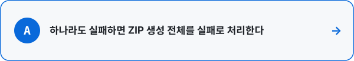</picture></a>
<a href="#s2-end"><picture><source media="(prefers-color-scheme: dark)" srcset="./assets/incident/ch_s2-env_B_dark.svg">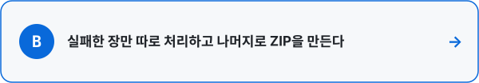</picture></a>

                                                  

---

## 🤔 한 장 때문에 전부 다시

<picture><source media="(prefers-color-scheme: dark)" srcset="./assets/incident/sc_s2-all-or-nothing_dark.svg"></picture>

안전해 보이지만, 행사 직전에 **한 장의 실패가 1,500장 전체를 다시 만들게** 합니다.

<a href="#s2-env"><picture><source media="(prefers-color-scheme: dark)" srcset="./assets/incident/btn_retry_dark.svg"></picture></a>

                                                  

---

## 🏁 실제로는 이렇게 했어요

<picture><source media="(prefers-color-scheme: dark)" srcset="./assets/incident/sc_s2-end_dark.svg"></picture>

> 아쉬운 점도 남깁니다. 운영 서버와 같은 환경에서 미리 돌려 보지 않아 행사 직전에 장애를 만났습니다.

📄 <a href="https://github.com/Jkim1647/portfolio/blob/main/projects/04-sarang-retreat.md">수양회 관리 시스템 기록</a>

<a href="#start"><picture><source media="(prefers-color-scheme: dark)" srcset="./assets/incident/btn_menu_dark.svg"></picture></a>

                                                  

---

## 3-1. 초록불이 가득하다

<picture><source media="(prefers-color-scheme: dark)" srcset="./assets/incident/sc_s3_dark.svg"></picture>

세 저장소를 리팩토링했고, 테스트가 **전부 통과**했습니다. 이제 어떻게 할까요?

<a href="#s3-ship"><picture><source media="(prefers-color-scheme: dark)" srcset="./assets/incident/ch_s3_A_dark.svg">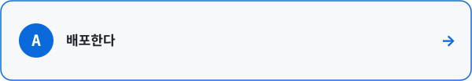</picture></a>
<a href="#s3-click"><picture><source media="(prefers-color-scheme: dark)" srcset="./assets/incident/ch_s3_B_dark.svg">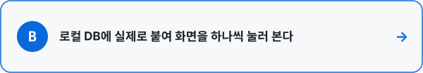</picture></a>

                                                  

---

## 🤔 입금 확인을 눌렀더니 500

<picture><source media="(prefers-color-scheme: dark)" srcset="./assets/incident/sc_s3-ship_dark.svg"></picture>

응답은 `500`인데 DB에는 이미 `PAID`가 저장돼 있습니다. mock 데이터로는 보이지 않던 버그입니다.

<a href="#s3"><picture><source media="(prefers-color-scheme: dark)" srcset="./assets/incident/btn_retry_dark.svg"></picture></a>

                                                  

---

## 3-2. 38개 화면을 눌러 보니 버그 12건

<picture><source media="(prefers-color-scheme: dark)" srcset="./assets/incident/sc_s3-click_dark.svg"></picture>

그중 하나: 입금 확인은 저장됐는데 **커밋 뒤에 보내는 문자 한 통이 실패하면서** 요청 전체가 `500`이 됐습니다. 어떻게 고칠까요?

<a href="#s3-rollback"><picture><source media="(prefers-color-scheme: dark)" srcset="./assets/incident/ch_s3-click_A_dark.svg">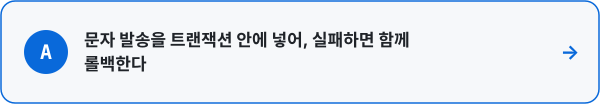</picture></a>
<a href="#s3-end"><picture><source media="(prefers-color-scheme: dark)" srcset="./assets/incident/ch_s3-click_B_dark.svg">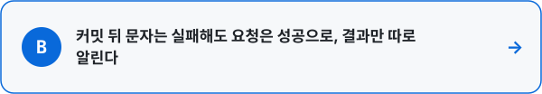</picture></a>

                                                  

---

## 🤔 문자는 되돌릴 수 없어요

<picture><source media="(prefers-color-scheme: dark)" srcset="./assets/incident/sc_s3-rollback_dark.svg"></picture>

DB는 롤백되지만 **이미 나간 문자는 회수할 수 없는 외부 효과**입니다.

<a href="#s3-click"><picture><source media="(prefers-color-scheme: dark)" srcset="./assets/incident/btn_retry_dark.svg"></picture></a>

                                                  

---

## 🏁 실제로는 이렇게 했어요

<picture><source media="(prefers-color-scheme: dark)" srcset="./assets/incident/sc_s3-end_dark.svg"></picture>

> mock 테스트가 모두 통과한 상태에서도 **실제 DB로 화면을 눌러 본 단계에서 12건이 더** 나왔습니다.

📄 <a href="https://github.com/Jkim1647/portfolio/blob/main/projects/07-sarang-retreat-refactor.md">수양회 시스템 2026 리팩토링 기록</a>

<a href="#start"><picture><source media="(prefers-color-scheme: dark)" srcset="./assets/incident/btn_menu_dark.svg"></picture></a>

                                                  

---

<a href="https://github.com/Jkim1647">프로필로 돌아가기</a>
